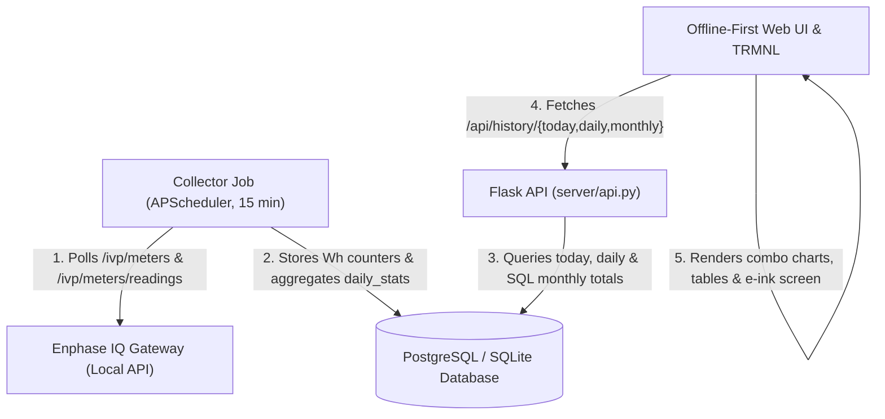

# Daily Energy Production & Tracking Integration

This document outlines the architecture, database schema, data collection strategy, energy accounting math, and UI integration used to track daily and monthly solar statistics inside `enphase-dashboard`.

---

## 1. System Architecture & Data Flow

### Key Design Principles
* **Cumulative Meter Accumulation**: To guarantee resiliency across restarts and outages, the collector logs monotonic **lifetime cumulative active energy counters** in Watt-hours (`Wh`) directly from the revenue-grade meters:
  * `production_wh`: Cumulative production energy delivered by the solar array (`actEnergyDlvd`).
  * `import_wh`: Cumulative grid energy imported (`actEnergyDlvd`).
  * `export_wh`: Cumulative grid energy exported (`actEnergyRcvd`).
* **Metadata-Based Meter Detection**: Instead of relying on hardcoded meter EIDs or fixed array positions, `get_meter_metadata()` caches `/ivp/meters` metadata (5-minute TTL) and `select_production_and_grid_meters()` selects the active `production` and `net-consumption` (or `total-consumption`) meters dynamically.

---

## 2. Database Schema Design

Both SQLAlchemy models live in [server/db.py](../server/db.py) and store timestamps as **naive UTC** datetimes (via `datetime.now(timezone.utc).replace(tzinfo=None)`) for full compatibility across SQLite and PostgreSQL.

### `meter_readings` (Raw Periodic Readings)
Stores cumulative hardware readings recorded every 15 minutes (and on manual sync).
* `timestamp` (`DateTime`, Primary Key, indexed): Naive UTC timestamp of the gateway reading.
* `production_wh` (`Float`, non-null): Cumulative production meter reading (`Wh`).
* `import_wh` (`Float`, non-null): Cumulative grid meter import reading (`Wh`).
* `export_wh` (`Float`, non-null): Cumulative grid meter export reading (`Wh`).

### `daily_stats` (Pre-Aggregated Daily Totals)
Stores pre-calculated local-day statistics for fast dashboard and TRMNL queries.
* `date` (`Date`, Primary Key): Local calendar date in the configured timezone.
* `production_kwh` (`Float`, non-null): Total solar production for the day (`kWh`).
* `import_kwh` (`Float`, non-null): Total grid import for the day (`kWh`).
* `export_kwh` (`Float`, non-null): Total grid export for the day (`kWh`).
* `consumption_kwh` (`Float`, non-null): Total house consumption for the day (`kWh`).
* `is_interpolated` (`Boolean`, default `False`): `True` when a cross-midnight outage (`> 2 hours`) required time-proportional interpolation across this day.
* `updated_at` (`DateTime`): Naive UTC timestamp of the last record update, refreshed on change.

---

## 3. Mathematical Formulas & Resiliency

### Target Timezone & Half-Open DST Boundaries
Raw readings are stored in naive UTC, while daily rollups are aligned to the configured local timezone (`timezone` in `configuration/config.yml`, defaulting to `America/New_York`):
1. `get_local_day_utc_bounds(day_date, target_tz)` converts local `00:00:00` of `day_date` and `00:00:00` of `day_date + 1 day` into naive UTC datetimes forming a **half-open interval** `[day_start, next_day_start)`.
2. Using half-open bounds handles 23-hour spring-forward and 25-hour fall-back DST transitions cleanly with zero missing seconds or boundary double-counting.

### Interval-Based Daily Aggregation
Rather than relying only on a day's first and last timestamps, `aggregate_day(day_date)` collects the reading immediately before `day_start`, all readings inside `[day_start, next_day_start)`, and the first reading at or after `next_day_start`, then sums consecutive intervals `(r_a, r_b)`:
1. **Intra-day intervals** (`r_a` and `r_b` both inside the day): Contribute `100%` of their counter delta. Same-day outages (`> 2 hours` starting and ending on the same local date) therefore stay exact (`is_interpolated = False`).
2. **Normal cross-midnight intervals** (`<= 2 hours`): Attributed `100%` to the day containing `r_b` (and `0%` to the day containing `r_a`), preserving exact energy conservation without estimation.
3. **Cross-midnight outage gaps** (`> 2 hours`): When `record_reading()` detects a cross-day gap exceeding `GAP_THRESHOLD` (`2 hours`), `interpolate_gap()` calls `aggregate_day()` for every calendar day spanned by the gap. Each spanned day receives the exact time-overlap fraction (`overlap_secs / total_secs`) of the gap delta, combined cleanly with any pre-outage or post-outage readings already recorded on the boundary days, and is flagged with `is_interpolated = True`.

Daily kWh totals are derived from the summed `Wh` deltas:
* **Solar Production**: `Production = prod_wh_total / 1000`
* **Grid Export**: `Grid Export = export_wh_total / 1000`
* **Grid Import**: `Grid Import = import_wh_total / 1000`
* **House Consumption**: `House Consumption = max(0, Production - Grid Export + Grid Import)`

### Canonical Daily Metrics (`GET /api/history/today` & TRMNL)
`compute_daily_metrics()` produces one canonical payload shared by both the Web UI and TRMNL e-ink renderer:
* **Net Grid Flow**: `export_kwh - import_kwh` (positive = net export, negative = net import).
* **Solar Coverage (%)**: `min(100, max(0, (max(0, production_kwh - export_kwh) / consumption_kwh) * 100))` (direct solar self-consumption as a share of house consumption, `0.0%` if consumption is `0`).
* **Freshness & Midnight Rollover**: Looks up `DailyStats` for today's local date (avoiding showing yesterday's totals after midnight) and marks `is_stale = True` if the latest `MeterReading` is older than `45 minutes`. TRMNL reflects these states in its footer (`ACTIVE`, `ESTIMATED`, `AWAITING DATA`, `STALE`, or `NO DATA`) and queries the trailing 7 local days of `DailyStats` for its 7-day trend bar chart.

---

## 4. Historical & Aggregation API Endpoints

Defined in [server/api.py](../server/api.py):
* `GET /api/history/today`: Returns today's canonical local-day metrics (`has_data`, `is_stale`, `net_grid_kwh`, `solar_coverage_pct`, and daily kWh totals). Polled every 60s by the Live tab.
* `GET /api/history/daily`: Returns ordered `DailyStats` rows; supports optional `?days=N`, `?start=YYYY-MM-DD`, and `?end=YYYY-MM-DD` date-window filters (used with `?days=14` by the Summary tab and full history by the History tab).
* `GET /api/history/monthly`: Aggregates `DailyStats` directly in SQL using portable `EXTRACT(year/month)` + `GROUP BY` / `SUM` queries (compatible with both SQLite and PostgreSQL).
* `POST /api/history/refresh`: Triggers an on-demand `record_reading()` sync, protected by a thread-safe in-flight guard and configurable cooldown (`history_refresh_cooldown_seconds`, default `30s`) returning `429 Too Many Requests` with `Retry-After` if called concurrently or within cooldown.

---

## 5. Summary of Code Implementations

* **[server/db.py](../server/db.py)**: Defines Flask-SQLAlchemy `MeterReading` and `DailyStats` models with naive UTC timestamps.
* **[server/config.py](../server/config.py)**: Manages mtime-cached YAML loading (`config.yml`, `system.yml`), the cached thread-safe `ManagedGateway` session with explicit timeouts and `401`/`403` re-auth, and JWT expiry decoding.
* **[server/dashboard_services.py](../server/dashboard_services.py)**: Implements metadata-based meter detection, 15-minute `record_reading()` ingestion, DST-safe interval aggregation (`aggregate_day()`), cross-day gap interpolation (`interpolate_gap()`), and canonical daily metrics (`compute_daily_metrics()` / `get_today_summary()`).
* **[server/api.py](../server/api.py)**: Exposes `/api/health`, `/api/token-status`, gateway proxy routes, historical endpoints (`/api/history/today`, `/api/history/daily`, `/api/history/monthly`, rate-limited `/api/history/refresh`), and authenticated TRMNL BYOS endpoints.
* **[server/app.py](../server/app.py)**: Side-effect-free `create_app()` factory that configures SQLAlchemy, optional `ProxyFix`, and `Flask-APScheduler` (15-minute readings job and periodic TRMNL render job) with `SCHEDULER_API_ENABLED = False`.
* **[docker-compose.yml](../docker-compose.yml)**: Runs PostgreSQL (`enphase-db`) with `pg_isready` healthcheck and `.env`-sourced credentials (`POSTGRES_PASSWORD`) alongside the non-root Gunicorn app container (`--workers 1 --threads 4`).
* **[templates/base.html](../templates/base.html)** & **[templates/tabs/history.html](../templates/tabs/history.html)**: Serve locally vendored `Alpine.js` and `Chart.js` (`static/vendor/`) with `Auto / Dark / Light` themes, `7D / 14D / 30D` history timeframe selector pills, a period summary strip, a Solar Coverage % column, pagination, and one-click CSV export.
* **[static/js/dashboard.js](../static/js/dashboard.js)**: Handles lazy tab loading, `7D / 14D / 30D` bar + line combo chart rendering (with House Consumption overlaid as a trend line), daily/monthly effectiveness charts, theme-aware Chart.js styling, and CSV export.
